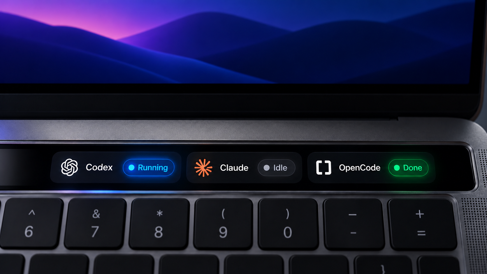

# cmux Touch Bar

Free local macOS helper, built from the included Swift and Objective-C source. No account, network service, or third-party runtime.



The image is a visual reference for the Touch Bar layout. The helper reads live cmux session state and updates each status card in real time.

## Requirements

- macOS 14 or newer with a Touch Bar
- cmux installed at `/Applications/cmux.app`
- Xcode Command Line Tools (`xcrun`, `swiftc`, and `clang`)

## Install

From a checkout, run:

```sh
./build.sh
```

The script builds the app into `~/Applications/cmux Touch Bar.app` and installs a per-user LaunchAgent at `~/Library/LaunchAgents/local.cmux-touchbar.plist`. Re-running it rebuilds and refreshes the installed helper. The source checkout can live anywhere in the home directory.

Installed app: `~/Applications/cmux Touch Bar.app`
Login agent: `~/Library/LaunchAgents/local.cmux-touchbar.plist`

The helper starts at login. Known cmux agent tabs remain visible when idle, with each tab showing its agent and status. The default display keeps the three most recently updated tabs; change that with `--set-max-sessions N`. The buttons display status only.

The cmux Touch Bar icon stays in the macOS menu bar so the helper is easy to find after the Touch Bar is closed. Click it to open cmux or quit the helper. Settings can also be changed from Terminal:
- `--set-display-mode always` shows the strip across apps.
- `--set-display-mode follow` follows cmux (the default).
- `--set-max-sessions N` changes the visible-tab limit.

Sessions are discovered from cmux's `~/.cmuxterm/*-hook-sessions.json` records and filtered against live process IDs and ancestry back to cmux. Codex uses cmux's `codex-monitor-leases` as the active-turn signal when a stale runtime record conflicts with hook events, while a `running` flag older than 60 seconds is treated as stale and returned to Idle. Other agents continue to use their cmux hook lifecycle states. No prompts or transcript content are displayed or copied.

**Colors:** Running = blue; Completed = green for 10 seconds; Idle = gray; Needs input (when reported by other agents) = orange. If no new Codex turn starts during the 10-second completion window, the box changes to Idle. Codex includes the locally installed CodexBar provider logo. Tap any box to bring cmux to the front. Missing Codex lifecycle data displays Unknown instead of a stale Idle value. Codex approval waits currently remain Running until the turn ends; they are not independently detected. Additional agents require their cmux hooks enabled, e.g. `cmux hooks setup <agent>`.

Regression tests: run the installed binary with `--self-test`. Covers new tasks overriding old Idle state, out-of-order completion, interruption, incremental reads, partial JSON, truncated files, logo loading, session layout and display modes.

Uses the undocumented AppKit system-modal Touch Bar API, so future macOS changes may require rebuilding. Does not modify cmux or require Accessibility access. No socket access or network access is used.

Build: `./build.sh`
Status: `~/Applications/cmux\ Touch\ Bar.app/Contents/MacOS/cmux-touchbar --status`
Help: `~/Applications/cmux\ Touch\ Bar.app/Contents/MacOS/cmux-touchbar --help`
Diagnostics: `~/Library/Application Support/cmux-touchbar/status.json`

Disable automatic startup and stop the helper:
`launchctl bootout gui/$(id -u) ~/Library/LaunchAgents/local.cmux-touchbar.plist`

Then move the app and login-agent plist to Trash to uninstall. The source checkout may be kept or removed.
